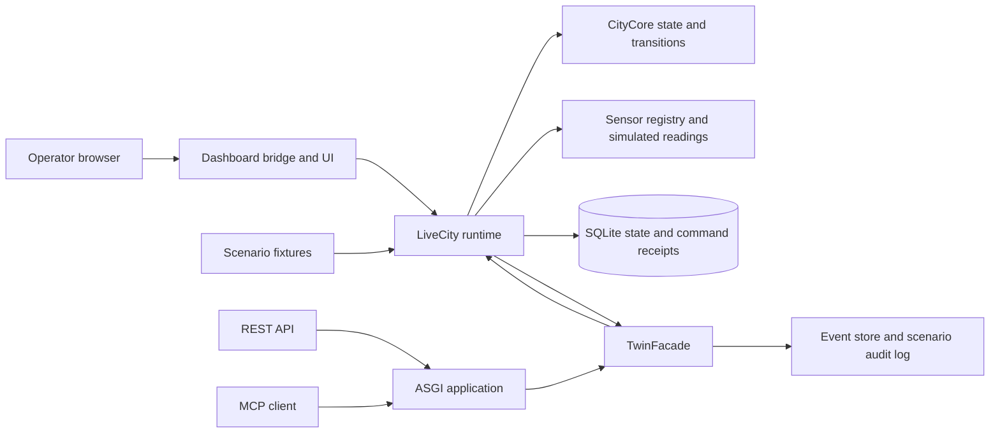

# Twin Layer Architecture

## System view

This view describes the software present in this repository. It does not imply that external Brain or Guardian services are running.

## Main components

- **CityCore** owns the modeled physical state and validates transitions/effects.
- **LiveCity** advances simulation ticks, updates sensor outputs, applies scenario triggers, and coordinates runtime services.
- **Sensor registry and physics** define devices and reported readings. Scenarios can seed readings or inject faults; some values are deliberately marked as scenario fixtures.
- **TwinFacade** is the shared integration gateway. It resolves a role, checks permissions and command constraints, calls the runtime, and projects public results.
- **ASGI application** exposes REST and MCP transports around the interface. Health endpoints are available for liveness/readiness.
- **Dashboard bridge** serves the operator UI and bounded local control endpoints.
- **Persistence and observability** save selected city/command state in SQLite and maintain event/audit records. Not all runtime state is durable; see [Verification](VERIFICATION.md).

## Typical data flow

1. A simulation tick or scenario trigger updates the runtime.
2. The sensor layer creates reported observations from modeled state and any configured fault.
3. The facade projects observations and events for an authorized caller.
4. A command request is checked for role, schema, device support, current state, safety restrictions, and idempotency.
5. Accepted effects are validated by the city model; rejected or pending requests produce an outcome without applying the effect.
6. The dashboard and event history let an operator inspect the resulting state and decision trail.

## Five domain areas

The current contract fixture names traffic, water, power, air quality, and emergency-call/response areas. Its own status labels are provisional and say cross-layer compatibility is unverified. Consult [`../fixtures/five_domain_contract.json`](../fixtures/five_domain_contract.json) before treating a field or partner mapping as finalized.

## Trust boundaries

- Scenario values and local test-role calls are controlled test inputs.
- Reported sensor values are separated from private simulated ground truth by projections; the dashboard's reported view should not be described as exposing physical truth.
- Commands cross a permission and validation boundary before reaching CityCore.
- External service behavior is outside this repository's demonstrated scope.
